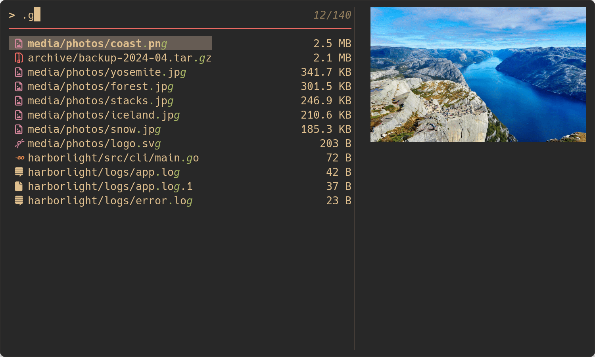

# f:st

f:st (`fs`) is a file manager that runs in your terminal, built around composable panes, asynchronous previews and transfers, and declarative TOML and Lua configuration.



```shell
curl -fsSL https://raw.githubusercontent.com/Squirreljetpack/fist/main/install.sh | sh
```

Start with [Getting started](./getting-started) for dependencies, package managers, shell integration, and a first-run tour.

- **The pane as the primitive** — directory listings, recursive file searches, full-text matches, visit history, stashes, applications, and custom command streams all share one pane stack and one set of keys.
- **Everything async and toasted** — directory walks, size calculation, previews, and queued file transfers run off the UI thread and report status through footer toasts.
- **Config-first** — panes, previews, lessfilter presets, menu actions, and transfer behavior live in plain TOML and Lua under `~/.config/fist`.
- **The matchmaker bind engine** — keys, mouse events, and lifecycle triggers map to composable bind action sequences scoped by pane or prompt state.

## Browse by topic

<div class="linear-sections-grid">
  <div class="linear-section-card">
    <div class="linear-section-header">
      <h3 class="linear-section-title">Getting started</h3>
    </div>
    <p class="linear-section-desc">How to install f:st, wire it into your shell, and learn the core keys.</p>
    <ul class="linear-link-list">
      <li class="linear-link-item"><a href="./getting-started"><span>Getting started</span><span class="arrow">→</span></a></li>
    </ul>
  </div>

  <div class="linear-section-card">
    <div class="linear-section-header">
      <h3 class="linear-section-title">Panes</h3>
    </div>
    <p class="linear-section-desc">How each pane populates its rows, transitions across the stack, filters, and sorts.</p>
    <ul class="linear-link-list">
      <li class="linear-link-item"><a href="./panes"><span>Panes</span><span class="arrow">→</span></a></li>
      <li class="linear-link-item"><a href="./navigation-in-depth"><span>Navigation in depth</span><span class="arrow">→</span></a></li>
      <li class="linear-link-item"><a href="./find-pane"><span>Find pane</span><span class="arrow">→</span></a></li>
      <li class="linear-link-item"><a href="./search-pane"><span>Search pane</span><span class="arrow">→</span></a></li>
      <li class="linear-link-item"><a href="./history-database"><span>History database</span><span class="arrow">→</span></a></li>
      <li class="linear-link-item"><a href="./stash-panes"><span>Stash panes</span><span class="arrow">→</span></a></li>
      <li class="linear-link-item"><a href="./custom-pane"><span>Custom pane</span><span class="arrow">→</span></a></li>
      <li class="linear-link-item"><a href="./mount-pane"><span>Mount pane</span><span class="arrow">→</span></a></li>
      <li class="linear-link-item"><a href="./visibility"><span>Visibility</span><span class="arrow">→</span></a></li>
      <li class="linear-link-item"><a href="./sorting"><span>Sorting</span><span class="arrow">→</span></a></li>
    </ul>
  </div>

  <div class="linear-section-card">
    <div class="linear-section-header">
      <h3 class="linear-section-title">Menu</h3>
    </div>
    <p class="linear-section-desc">How to script contextual menu actions in Lua and run background transfers on the queue.</p>
    <ul class="linear-link-list">
      <li class="linear-link-item"><a href="./lua"><span>Lua</span><span class="arrow">→</span></a></li>
      <li class="linear-link-item"><a href="./menu-actions"><span>Menu actions</span><span class="arrow">→</span></a></li>
      <li class="linear-link-item"><a href="./queue"><span>Queue</span><span class="arrow">→</span></a></li>
    </ul>
  </div>

  <div class="linear-section-card">
    <div class="linear-section-header">
      <h3 class="linear-section-title">Configuration</h3>
    </div>
    <p class="linear-section-desc">How to configure application behavior, TUI layout, key bindings, preview dispatch, and paging.</p>
    <ul class="linear-link-list">
      <li class="linear-link-item"><a href="./configuration"><span>config.toml</span><span class="arrow">→</span></a></li>
      <li class="linear-link-item"><a href="./mm.toml"><span>mm.toml</span><span class="arrow">→</span></a></li>
      <li class="linear-link-item"><a href="./lessfilter"><span>lessfilter</span><span class="arrow">→</span></a></li>
      <li class="linear-link-item"><a href="./pager"><span>Pager</span><span class="arrow">→</span></a></li>
    </ul>
  </div>

  <div class="linear-section-card">
    <div class="linear-section-header">
      <h3 class="linear-section-title">Mechanics</h3>
    </div>
    <p class="linear-section-desc">How f:st integrates with your shell, parses command-line flags, exposes subtools, and expands templates.</p>
    <ul class="linear-link-list">
      <li class="linear-link-item"><a href="./shell-integration"><span>Shell integration</span><span class="arrow">→</span></a></li>
      <li class="linear-link-item"><a href="./command-line"><span>Command line</span><span class="arrow">→</span></a></li>
      <li class="linear-link-item"><a href="./tools"><span>Tools</span><span class="arrow">→</span></a></li>
      <li class="linear-link-item"><a href="./output-templates"><span>Output templates</span><span class="arrow">→</span></a></li>
    </ul>
  </div>
</div>

Next: [Getting started](./getting-started) · [Panes](./panes)
