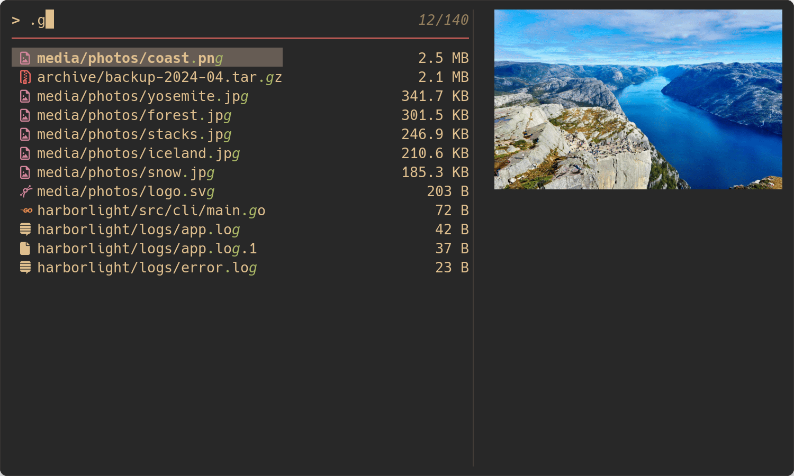

# Sorting

f:st supports ordering rows by name, modification time, access time, recursive size, or native stream/frecency order, using either soft sorting (blended with query relevance) or hard sorting (strictly ordered by the sort key).

## Sort orders

| Sort order | Key | Meaning |
| --- | --- | --- |
| `name` | Alphabetical | Case-insensitive natural path ordering |
| `mtime` | Modification time | Newest modified first |
| `atime` | Access time | Most recently accessed first |
| `size` | Byte size | Largest first (files and recursive directory sizes) |
| `none` (`frecency`) | Native / frecency | Unsorted stream order, or frecency score in database panes |

Availability depends on the pane:

- **Nav, Find, Stash, and Custom** support all five orders (`name`, `mtime`, `atime`, `size`, `none`).
- **Search** supports `name`, `mtime`, `atime`, and `none`. It omits `size` because rows represent individual line matches inside files rather than whole filesystem entries.
- **History (`Files`, `Folders`) and App** relabel `none` as `frecency` and sort via SQL (`frecency`, `mtime`, `atime`, `size`, `name`).

## Choosing a sort

You can pick a sort order on the command line, in the Options overlay, or through keybindings:

- **Command line** — pass `--sort <ORDER>` (`name`, `mtime`, `atime`, `size`, `none`, `frecency`) to `fs`, `fs ::`, `fs :`, `fs :dir`, `fs :file`, `fs :custom`, or `fs :info`.
- **Options overlay (`alt-p`)** — move to the **Sort** column and press `Enter` on `name` (`n`), `mtime` (`m`), `atime` (`a`), or `size` (`s`).
- **Bind actions** — bind keys to `SetSort(order)` in [mm.toml](./mm.toml), or press `ctrl-d` (`CycleFilter`) inside a History pane to toggle between `frecency` and `mtime`.

<video controls preload="none" poster="./images/sort.png" src="./images/sort.mp4"></video>

## Soft sort and hard sort

f:st distinguishes between **soft sorting** and **hard sorting**:

- **Soft sort** is engaged by a pane's `default_sort` in [config.toml](./configuration#panes). When the query is empty, rows appear in `default_sort` order; as soon as you type a query, fuzzy match quality and the sort order combine so strong text matches rise to the top while ties break by the sort key. Soft sorting hides the sort value badge in column 2 to keep the listing uncluttered.
- **Hard sort** is engaged when you pass `--sort` on the CLI or select a sort interactively in the Options overlay (`alt-p`) or via `SetSort`. A hard sort strictly orders matching rows by the sort key regardless of fuzzy score and displays the formatted sort value (`4.0 MB`, `2m ago`) in the tail column.

In the **Search**, **History (`Files`, `Folders`)**, and **App** panes, sorting is always soft so query relevance and context columns remain intact.

`[interface] stability_threshold` in [config.toml](./configuration#interface) (default `30`) dampens re-sorting across background reloads when scores change by less than the threshold; set `0` to re-sort on every update.

## Size sorting

Selecting `size` computes recursive directory sizes in the background without blocking the UI.

Computed directory sizes are cached for the active directory. Navigating to a different directory drops the cache unless `[interface] preserve_size_cache = true` is set in [config.toml](./configuration#interface). The same parallel size engine powers `fs :tool diskspace`; see [Tools](./tools#diskspace).

## External ordering

Most panes re-sort their in-memory row list on the fly without re-running the producer. Two cases reload instead:

- **Database panes (`Files`, `Folders`, `Apps`)** execute their `ORDER BY` clause in SQLite and repopulate from the database when the sort changes.
- **Custom panes with `--no-store`** do not retain rows in memory and cannot re-sort after the stream finishes; omit `--no-store` when you need interactive sorting or filtering in `fs :custom`.

## Per-pane defaults

Each pane configures its initial soft sort via `default_sort` under `[panes.<name>]` in [config.toml](./configuration#panes):

| Pane | Shipped `default_sort` |
| --- | --- |
| `nav` | `"mtime"` |
| `find` | `"none"` |
| `search` | `"none"` |
| `files`, `dirs`, `app` | `"none"` (`frecency`) |
| `custom`, `stashes` | `"none"` |

When you open History (`ctrl-g`) or the App pane from another pane and then back out, the previous pane keeps its own sort order rather than inheriting the database pane's sort.
